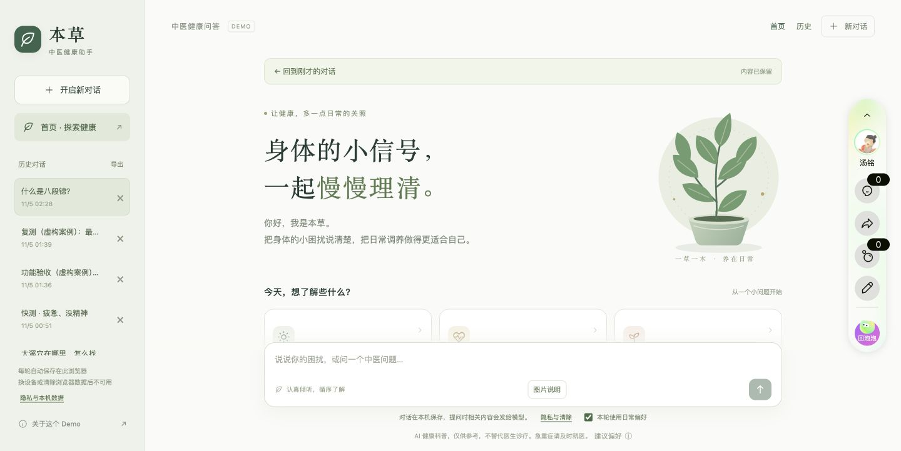
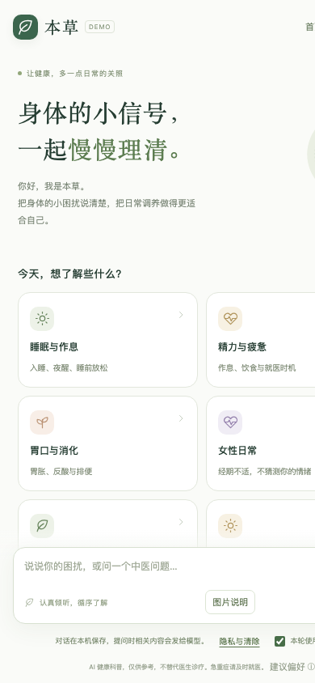
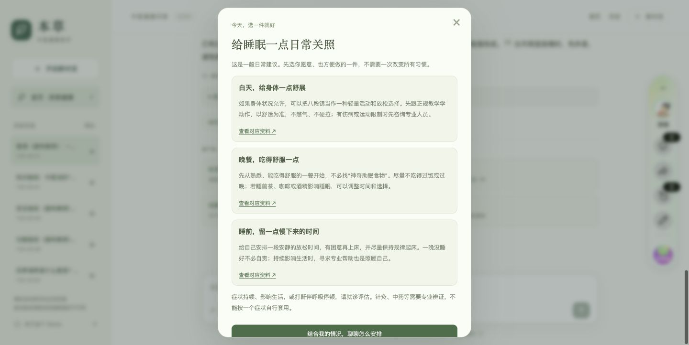
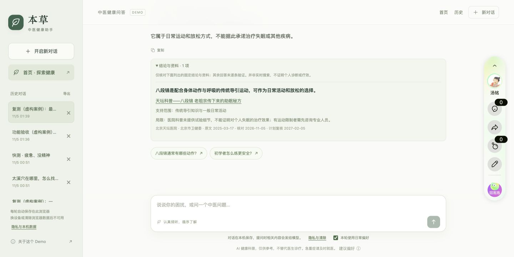
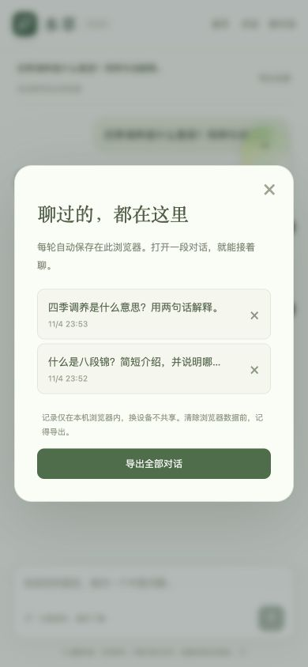

# 本草 · 中医健康助手

面向百度搜索健康问题的中医健康信息与日常调养助手。当前作品是一个受控 Alpha Demo，用来验证搜索后的连续问答、风险边界、精选资料引用和本机历史。

- 直接体验：[本草 · 中医健康助手（POPO 外部授权链接）](https://bencao-tcm-tm.popo.baidu.com/?k=psajtik7)
- 公开代码：[jimmyoyang/bencao-tcm-agent](https://github.com/jimmyoyang/bencao-tcm-agent)
- 当前 POPO 版本：v17
- 当前模型：gpt-6.1-sol
- POPO 授权链接的有效性和可见范围由 POPO 控制，链接失效时请从线上作品页进入

## 项目背景

百度健康连接了搜索、健康内容和医疗服务。用户从搜索进入时，往往已经带着一个具体问题，例如睡不好、饭后胃胀、最近总是疲惫，或想了解八段锦。用户需要先听懂一段解释，再知道今天能做什么，也要知道什么时候应该寻求专业帮助。

我把本草设计成搜索后的第二步交流。它帮助用户把模糊的困扰说清楚，把健康内容整理成结论、行动、依据和边界，并在用户需要时生成可核对的就医摘要。

本项目重点验证三件事。

1. 文章内容能否转成用户看得懂的结论和行动
2. 一次回答能否自然承接下一轮交流
3. 对话信息能否在用户确认后整理成就医摘要

## 用户与产品定位

首版面向通过百度搜索进入、希望了解中医知识或处理轻度日常困扰的成年人。

当前覆盖六个主题。

- 睡眠与作息
- 精力与疲惫
- 胃口与消化
- 女性日常
- 情绪与压力
- 日常活动与养生

本草可以帮助用户理解问题、补充必要信息、选择安全的日常行动和整理就医信息。自动辨证、开方、药物剂量、单凭舌苔图片诊断、实时医疗服务不属于当前 Demo 的能力范围。

## 设计判断

### 先回答，再收集必要信息

用户第一次提问时先获得一段有用回答。系统只追问会改变建议或安全判断的信息，减少一上来填写完整病历的压力。

### 把知识问题和症状问题分开

“什么是八段锦”属于知识问答，不应自动进入睡眠问诊。“最近两周睡不好”属于症状交流，才需要考虑持续时间、生活影响和需要留意的情况。意图和主题在每轮单独记录，切换话题时不沿用旧主题。

### 把依据和边界放在同一张卡里

精选资料被拆成结论、行动、禁忌、适用范围、原文摘录和不确定性。页面只展示本轮实际使用且通过程序校验的来源，资料不足时停止补充，不用无关内容凑满答案。

### 收敛下一步

回答后的卡片最多保留一个主行动和一个次行动。用户可以补充情况、记录感受、继续追问或打开就医摘要，避免多个按钮同时争夺注意力。

### 让健康记录可控

每轮问题、回答、确认信息和依据都保存在当前浏览器。健康事实最长 7 天用于后续问答，日常偏好最长 30 天，用户可以修改、撤回、导出或清除。图片只做本机临时预览和质量提示，不上传、不诊断。

## 参考产品与借鉴

| 参考产品 | 观察 | 本草的取舍 |
| --- | --- | --- |
| 豆包等通用 Agent | 自然语言输入，连续追问，能承接下一轮 | 保留自由提问，把追问收敛为关键问题，并加入三题快测和风险分流 |
| 豆包、Perplexity 等资料型问答 | 回答中展示参考资料 | 使用精选知识卡，展示结论、来源、支持范围和不确定性 |
| 百度健康、丁香医生等健康产品 | 健康内容与专业服务有明确关系 | 形成信息理解、日常行动、就医摘要和专业承接的路径 |
| Keep 等生活方式产品 | 轻量行动和记录降低开始门槛 | 提供“今天先做一件小事”和“记录今日感受”，不增加连续打卡压力 |

## 核心功能

### 首页主题入口

首页提供六个生活化主题卡片。用户可以点击熟悉的问题开始，也可以直接在输入框自由提问。

当前首页已经去掉与结构化问诊重复的“最近睡不好？一起理清楚”和“也可以从这里开始”场景栏。睡眠知识卡仍然保留，睡眠问诊只在回答后的下一步中出现。

### 三题快测

快测依次询问当前最困扰的事情、持续时间和希望获得的帮助。

- 每题可以返回或跳过
- 结果用于生成初步小结和选择回答策略
- 选项不会被直接翻译成体质、证型或疾病
- 急症和特殊人群规则优先于快测结果

### 结构化问诊

问诊围绕困扰类型、持续时间、日常影响和需要留意的情况展开。问题采用选填设计，用户可以跳过；确认后才保存并发送给模型，之后可以修改或撤回。

### 回答与证据卡

回答页面由四部分组成。

- 核心回答，先回应当前问题
- 日常行动，给出一到三件今天可以尝试的小事
- 依据说明，展示实际使用的资料、支持范围和不确定性
- 下一步卡片，承接补充情况、记录感受、继续追问和就医摘要

### 历史与就医摘要

每轮内容会保存到当前浏览器。刷新后可以继续对话，也可以导出全部记录。就医摘要保留用户原话和已确认信息，用户核对后再复制给医生或药师。

### 图片入口

当前图片入口只做本机预览、格式检查、分辨率检查、曝光提示和细节提示。照片不会上传给模型，也不会用于舌象或体质诊断。

如果未来接入视觉模型，需要先验证图片质量、隐私清除、拒答能力和人工审核流程。

## 产品与技术架构

~~~mermaid
flowchart LR
    A[百度搜索或首页入口] --> B[自由提问与三题快测]
    B --> C[意图 主题 人群 风险预筛]
    C -->|急症或专业边界| D[就医提示与就医摘要]
    C -->|可回答| E[精选知识卡检索]
    E --> F[POPO 模型流式回答]
    F --> G[结论 来源 风险字段校验]
    G --> H[回答 行动 依据 下一步]
    H --> I[本机历史与可控记录]
~~~

### 技术栈

| 层级 | 实现 |
| --- | --- |
| 页面 | HTML5、CSS3、原生 JavaScript ES Modules |
| 交互 | 原生 Dialog、表单、Radio、File API、localStorage、sessionStorage |
| 模型 | POPO PopSDK，OpenAI 兼容的流式 Chat Completions 请求 |
| 检索 | Node.js 构建脚本、本地 BM25 倒排索引、中文短词切分和主题过滤 |
| 内容 | JSONL 原始卡片、JSON 来源注册表、构建后的页面索引 |
| 测试 | Node.js node:test、Python unittest、浏览器模拟服务 |
| 发布 | POPO 静态站点，只发布 public/ |
| 自有后端 | 当前没有独立业务服务器和数据库，历史仅保存在用户当前浏览器 |

### 内容数据结构

每张知识卡包含以下信息。

- claim 结论
- action 日常行动
- contraindication 禁忌和停止条件
- risk 风险级别
- sourceId 和 sourceSpan 来源及原文摘录
- supportScope 支持范围
- uncertainty 不确定性
- populations 和 exclusions 适用人群与排除条件
- knowledgeType 一般健康知识、中医养生、穴位位置或安全边界

当前资料库包含 80 张卡和 19 个来源。人工医学审核仍未完成，卡片审核为 0/80，来源审核为 0/19。verified-index.json 当前为 blocked，所以项目可以演示工程流程，不能宣称已经形成经过人工核验的中医问诊知识库。

## 版本迭代

| 版本 | 主要变化 | 设计原因 |
| --- | --- | --- |
| v14 | 从睡眠单主题扩展为六主题资料问答，加入主题过滤、证据展示和高风险前置 | 先验证核心问答和安全边界 |
| v15 | 扩充到 80 张卡、19 个来源，加入穴位位置科普、图片本机质量提示和更完整的历史恢复 | 覆盖更多常见问题，同时保留能力边界 |
| v16 | 加入来源级和卡片级人工审核表、来源新鲜度、问题编码和 verified-index 门禁 | 让资料能否上线有明确状态，不把机器整理写成医学审核 |
| v17 | 首页移除重复的睡眠问诊入口和场景栏，保留睡眠知识入口、问答后问诊和日常偏好 | 减少首页分流，让入口与回答后的下一步职责一致 |

## 截图

### 桌面端首页与回答

### 手机端首页与连续对话

### 结构化问诊与证据卡

| 结构化问诊 | 依据卡 |
| --- | --- |
|  |  |

### 历史与就医摘要

## 功能优先级

| 优先级 | 功能 | 当前状态 | 下一步 |
| --- | --- | --- | --- |
| P0 | 六主题入口与自由提问 | 已完成 | 用真实搜索问题调整主题排序 |
| P0 | 三题快测 | 已完成 | 观察完成率、首轮帮助度和继续提问率 |
| P0 | 结构化问诊、修改、撤回、历史 | Demo 已完成 | 做真实用户可用性测试 |
| P0 | 精选资料检索与依据卡 | Demo 已完成 | 完成人工引用和适用边界审核 |
| P0 | 高风险前置和证据不足弃答 | Demo 已完成 | 验证漏分流和误拦截 |
| P1 | 女性主动记录、症状标签和饮食偏好 | 设计阶段 | 先验证自愿记录、隐私接受度和日记总结 |
| P1 | 适老化 | 研究假设 | 先确认百度搜索用户年龄分布，再测试字号、语音和家人协助 |
| P1 | 医院与企业微信承接 | 已有就医摘要 Demo | 与合作 PM 确认授权、服务流程和归因 |
| P2 | 图片识别和舌象分析 | 当前只有本机预览 | 先完成图片质量和模型安全验证 |
| P2 | 实时搜索、帖子和视频 | 暂未接入 | 只在价值明确时使用白名单来源 |
| P2 | 商业推荐和付费问诊 | 暂不展开 | 等信任、服务供给和合作归因稳定后推进 |

## 为什么暂缓实时搜索

当前首批问题先使用精选资料。

- 实时搜索会增加等待时间、模型调用和抓取成本
- 帖子和视频的质量、版权、链接失效和来源追溯需要额外处理
- 用户看到更多内容，不一定更容易完成一个安全的日常行动
- 精选资料更适合先验证回答速度、引用关系和边界表达

后续可以在白名单医疗来源中加入定向搜索、缓存和少量结果展示。搜索失败时继续使用已有安全回答。

## 验证结果

以下结果来自合成回归集和浏览器模拟，不代表临床准确率或真实用户满意度。

- Node 测试 73/73
- Python 测试 3/3
- 精选资料构建成功，80 张卡、19 个来源
- 检索回归 85 题，Recall@3 为 82/85，约 96.47%
- 100 条安全红队全部通过
- 60 条预期高风险样例普通检索放行 0
- 36 条普通对照误拦截 0
- 本地检索 P95 约 0.33ms，未计入模型响应时间

尚未取得的证据包括人工引用正确率、真实高频问题覆盖、真实意图准确率、用户满意度和临床急症召回率。

## 当前边界

- 人工医学和引用审核尚未完成
- 当前资料以一般健康教育为主，只有少量中医养生、导引和穴位位置科普
- 没有处方、药物剂量、针灸操作、舌象诊断和实时医疗服务
- 图片不上传、不诊断、不保存
- 历史、偏好和健康记录不跨设备同步
- 风险规则不能覆盖所有表达，未被拦截不代表安全
- 合成测试不能替代真实用户测试和临床评估

## 后续路线

1. 完成 80 张知识卡的人工引用、适用范围和安全边界审核
2. 获取真实、脱敏、经授权的问题集，建立独立评估集
3. 增加快测完成、回答帮助度、依据点击、用户纠正和弃答等最小统计
4. 进行内部 Alpha 和小范围灰度，设置安全、延迟和回滚标准
5. 根据用户研究推进女性记录、适老化、图片能力和医院承接
6. 在内容和服务稳定后，再评估实时搜索、视频内容和商业推荐

## 目录结构

~~~text
.
├── public/                  页面、交互、策略、检索索引
├── data/                    JSONL 知识卡与来源原稿
├── tests/                   Node、Python 和浏览器模拟测试
├── tools/                   知识构建、评估和模型配置工具
├── docs/                    方案、评审、验收和审核门禁
├── screenshots/             体验截图
├── PLAN.md                 实施计划
└── README.md               项目说明
~~~

## 发布说明

POPO 发布只上传 public/，不会上传测试、文档、截图、配置工具或模型 Key。模型 Key 由 POPO 服务端保存，源码中只保留模型 ID。每次发布前会做基线校验，发布后回读作品状态并保留 ZIP 备份。
