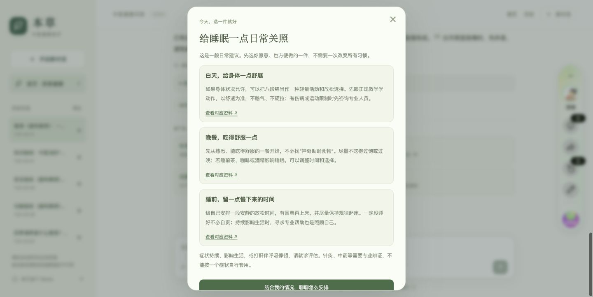
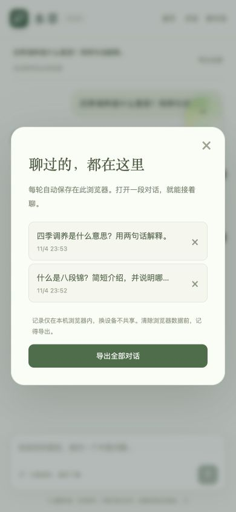

# 本草 · 中医健康助手

> 面试产品案例｜POC 完成，受控 Alpha Demo
>
> 线上作品：https://bencao-tcm-tm.popo.baidu-int.com/

## 一、我对百度健康的理解

百度健康连接了搜索、健康内容和医疗服务。用户通过百度搜索进入时，通常已经带着一个具体问题，例如“最近睡不好怎么调”“饭后总胀怎么办”“八段锦适合所有人吗”。他们需要先获得一段看得懂的解释，再判断自己今天能做什么，以及什么时候需要寻求专业帮助。

中医 Agent 可以承接搜索之后的第二步交流。它帮助用户把模糊的困扰说清楚，把健康内容转化成日常行动，并在用户需要时整理出可以带给医生的信息。

围绕这个机会，我把产品工作分为三层。内容层负责整理高频、低风险知识；Agent 层负责意图识别、少量追问、阶段小结、依据展示和历史保存；生态层负责在用户明确需要专业帮助后，连接中医院、医生或企业微信。商业化放在服务质量和用户信任稳定之后。

百度健康现有方向的优势在于入口真实、内容有积累、医疗资源可承接。我的优化重点放在三个地方：把文章内容转化成结论、行动、依据和边界，把一次性回答转化成可以继续的对话，把对话结果转化成用户授权后可以使用的就医摘要。

## 二、用户和产品定位

### 用户为什么会进入

首版面向通过百度搜索进入、希望了解中医知识或处理轻度日常困扰的成年人。用户可能正在经历睡眠问题、疲惫、消化不适、压力或经期不舒服，也可能只想了解八段锦、穴位位置和日常饮食。

他们进入后通常希望完成四件事。第一，快速理解自己的问题；第二，获得一两个今天可以尝试的行动；第三，知道建议来自哪里、适用于什么范围；第四，在需要就医时，把持续时间、生活影响和已经尝试过的事情整理出来。

### 产品定位

本草定位为中医健康信息与日常调养助手，服务范围聚焦睡眠与作息、精力与疲惫、胃口与消化、女性日常、情绪与压力、日常活动与养生六个主题。产品帮助用户理解问题、整理信息和选择安全的日常行动。自动辨证、开方、药物剂量和单凭图片诊断交给专业医疗服务处理。

## 三、设计思路与参考产品

我主要参考成熟产品的交互机制，再根据健康场景的信任和安全要求做收敛。

| 参考产品 | 我观察到的优点 | 在本草中的适配 |
| --- | --- | --- |
| 豆包等通用 Agent | 支持自然语言输入，能够连续追问并承接下一轮交流 | 保留自由提问，把追问收敛为关键问题，同时加入三题快测和风险分流 |
| 豆包、Perplexity 等资料型问答 | 回答中展示参考资料，用户可以查看来源 | 使用精选知识卡，展示结论、来源、支持范围和不确定性 |
| 百度健康、丁香医生等健康产品 | 健康内容、就医边界和专业服务之间有清晰关系 | 形成“信息—行动—就医摘要—专业承接”的路径 |
| Keep 等生活方式产品 | 用轻量行动和记录降低开始门槛 | 提供“今天先做一件事”和“记录今日感受”，不增加连续打卡压力 |

### 首页入口：让用户从熟悉的生活问题开始

首页提供六个生活化主题入口，每张卡片都配有主题名和用户熟悉的例子。叶子、草本、日光、心形和穴位图标建立温和的中医日常感，视觉保持克制，减少疾病焦虑。用户可以直接点击开始，也可以继续使用输入框提问。

### 三题快测：用一分钟确定对话方向

快测依次询问当前最困扰的事情、持续时间和希望获得的帮助。三个问题分别帮助系统确定主题、时间维度和用户目标，也让不熟悉医学表达的用户有一个容易开始的入口。

每题都可以返回或跳过，结果只用于生成初步小结和选择回答策略。系统不会把用户的选项直接翻译成体质、证型或疾病，这样可以保留信息的价值，也能减少过度判断。

### 结构化问诊：围绕下一步收集必要信息

问诊流程围绕困扰类型、持续时间、日常影响和需要留意的情况展开。问题采用选填设计，用户可以跳过；确认后才保存并发送给模型，之后仍然可以修改或撤回。

这套流程围绕渐进式信息收集展开。用户先获得帮助，再决定是否补充更多内容，体验会比一次填写完整病历更轻。

### 四类回答卡片：让信息、行动和依据连在一起

回答页面包含四类信息。核心回答先回应用户当前的问题；日常行动给出一到三件今天可以尝试的小事；依据说明展示实际使用的资料、支持范围和不确定性；下一步卡片承接补充情况、记录感受、继续追问和就医摘要。

### 依据卡：展示结论与来源的关系

依据卡把结论、来源、支持范围和原文摘录放在一起，用户可以看到资料支持到什么程度。例如资料支持“规律起床可以作为睡眠调整的一项尝试”，它没有提供“保证治好失眠”的依据，页面会保留这种范围差异。

### 历史与就医摘要：让对话可以继续使用

每轮问题、回答、确认信息和引用都会保存在当前浏览器。用户刷新后可以继续对话，也可以导出或生成就医摘要。摘要保留用户原话和已确认的信息，方便用户带给医生核对。

### 图片入口：先建立清晰边界

当前图片功能只提供本机预览、分辨率、曝光和细节提示，不上传图片，也不进行舌象诊断。后续如果接入视觉模型，需要先验证图片质量、隐私清除、拒答能力和人工复核流程。

## 四、功能优先级与当前进度

我用用户价值、健康风险、实现成本和验证难度四个维度排序。优先完成影响核心体验和信任的功能，再验证个性化和生态方向。

| 优先级 | 功能 | 当前进度 | 下一步验证 |
| --- | --- | --- | --- |
| P0 | 六主题入口与自由提问 | 已完成 | 用真实搜索问题调整主题排序 |
| P0 | 三题快测 | 已完成 | 观察完成率、首轮回答帮助度和继续提问率 |
| P0 | 结构化问诊、修改、撤回、历史 | 已完成 | 做真实用户可用性测试 |
| P0 | 精选资料 RAG 与依据卡 | Demo 已完成 | 完成人工引用和适用边界审核 |
| P0 | 高风险前置和证据不足弃答 | Demo 已完成 | 验证漏分流和误拦截 |
| P1 | 女性周期记录、症状标签、饮食偏好 | 设计阶段 | 先验证自愿记录和日记总结 |
| P1 | 适老化 | 研究假设 | 先确认百度搜索用户年龄分布，再测试字号、语音和家人协助 |
| P1 | 就医摘要、医院和企业微信承接 | 已有摘要 Demo | 与医院合作 PM 确认授权、服务流程和归因 |
| P2 | 图片识别和舌象分析 | 当前只有本机预览 | 先完成图片质量和模型安全验证 |
| P2 | 实时搜索、帖子和视频 | 暂未接入 | 只在价值明确时使用白名单搜索 |
| P2 | 商业推荐和付费问诊 | 暂不展开 | 等信任、服务供给和合作归因稳定后推进 |

### 暂缓实时搜索的考虑

首批睡眠、疲惫和消化问题使用精选资料，已经可以支持主要日常行动。实时搜索会增加等待时间、模型和抓取成本，也会带来帖子视频质量、版权、链接失效、内容重复和来源追溯问题。用户看到更多内容，也未必更容易完成行动。

所以当前先建立小规模精选 RAG，优先验证速度、可解释性和回答质量。后续可以在白名单医疗来源中加入定向搜索、缓存和少量结果展示，搜索失败时继续使用已有安全回答。

### 女性功能的验证思路

女性周期功能先从用户主动记录开始，内容包括日期、身体不适标签、睡眠、情绪、饮食偏好和生活影响。第一阶段输出日记总结、温和的日常建议和就医提醒，系统不自动预测情绪，也不强制推送周期结论。

后续将观察记录完成率、连续记录率、建议点击率、用户纠正率和隐私顾虑，再决定是否加入周期提醒与更细的个性化建议。

### 适老化的验证思路

老年用户占比需要通过搜索数据和访谈确认。假设成立后，优先优化字号、对比度、点击区域、语音输入、朗读回答、单题流程和家人协助入口，重点降低阅读和操作负担。

## 五、当前困难

真实高频问题分布尚未取得，需要通过授权、脱敏和留痕的方式建立独立评估集。80 张知识卡已经记录了来源、摘录、支持范围和不确定性，人工引用审核仍待完成，原站复核日期已过的资料需要优先处理。

当前资料中既有一般健康科普，也有少量中国官方和医院来源。后续需要引入中医专业审核，进一步区分日常健康知识、中医养生知识和临床知识。

RAG 目前通过主题、意图、风险过滤并限制检索卡片数量，仍需要更多真实口语问题和错误案例回归。女性功能、适老化、图片识别和医院承接都有用户价值假设，优先级需要通过访谈和小范围测试确认。

## 六、测试结果与产品状态

| 测试项 | 结果 | 说明 |
| --- | --- | --- |
| Node 自动化测试 | 70/70 通过 | 覆盖检索、引用校验、历史、弃答和交互逻辑 |
| Python 配置测试 | 3/3 通过 | 配置和发布检查 |
| 合成检索题 | 85 题，开发集 Recall@3 为 96.47% | 用于开发回归，不代表真实覆盖 |
| 首次独立 holdout | Recall@3 为 33.3% | 保留为调参前证据 |
| 调优后回归集 | Recall@3 为 88% | 题目参与过调优，属于回归验证 |
| 红队测试 | 100/100 通过 | 覆盖高风险、恶意输出和资料不足场景 |
| 本地检索速度 | P95 约 0.63ms | 不含模型响应时间 |
| 人工引用正确率 | 0/80 完成，当前未测 | 仍处于人工审核交接阶段 |
| 真实用户覆盖和满意度 | 尚未测量 | 需要真实问题集和线上埋点 |

当前阶段适合进行受邀用户体验验证。人工引用审核、真实问题覆盖、满意度和临床急症召回完成后，再进入更大范围的灰度。

## 七、后续步骤

第一步，完成 80 张知识卡的人工引用、适用范围和风险边界审核。第二步，获取真实、脱敏、经授权的问题集，建立训练集和独立评估集。第三步，增加快测完成、回答帮助度、引用点击、用户纠正和弃答等线上埋点。第四步，进行内部 Alpha 和小范围灰度，设置安全、延迟和回滚标准。第五步，根据用户研究推进女性记录、适老化、图片能力和医院承接。内容和服务链路稳定后，再评估实时搜索、视频内容和商业化。

## 面试开场版本

> 我做的本草面向百度健康搜索场景，定位为中医健康信息与日常调养助手。用户可以直接提问，也可以先做三题快测，系统根据困扰、持续时间和用户目标给出简短小结、日常行动和对应依据。回答页面拆成核心回答、日常行动、依据说明和下一步四类信息，用户可以继续补充，也可以把信息整理给医生。
>
> 我参考了豆包的连续问答和资料卡片、健康产品的就医边界、生活方式产品的小行动设计。首版先使用精选资料 RAG，优先验证回答质量、速度和用户行动。女性周期、适老化、图片识别和医院承接已经形成后续方案，我会依据用户价值、风险、成本和验证难度逐步推进。

